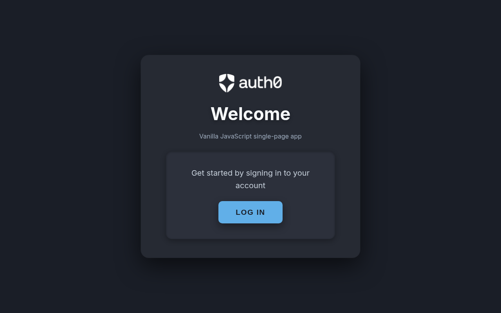

# Auth0 login flow

Vanilla JavaScript single-page app for the MLH Global Hack Week challenge **Set up your first Auth0 log-in flow**. It follows the [Auth0 Vanilla JavaScript SPA quickstart](https://auth0.com/docs/quickstart/spa/vanillajs) and loads [`@auth0/auth0-spa-js`](https://github.com/auth0/auth0-spa-js) from Auth0's CDN.

Log in with Universal Login, return to this page, and the app shows your name, email, picture, and ID token claims. Log out returns you here. The session is stored in `localStorage` and renewed with refresh tokens.

## Live demo

https://yniantongtian-oss.github.io/ghw-auth0-login/



## Auth0 configuration

These are public SPA identifiers. A single-page app does not use a client secret, so they are safe to commit.

| Setting | Value |
| --- | --- |
| Domain | `dev-wvxvhbnjrgvgn26x.us.auth0.com` |
| Client ID | `PdhQXfHFZsBbDq4I9LuOvvTtMSILNqPt` |
| Allowed callback URLs | `http://localhost:3000` and `https://yniantongtian-oss.github.io/ghw-auth0-login/` |
| Allowed logout URLs | `http://localhost:3000` and `https://yniantongtian-oss.github.io/ghw-auth0-login/` |

`redirect_uri` (and the logout `returnTo` URL) is `window.location.origin + window.location.pathname`. That is `http://localhost:3000/` locally and `https://yniantongtian-oss.github.io/ghw-auth0-login/` on GitHub Pages. Open the Pages site at that directory URL, not `index.html`.

The Auth0 client is created with:

- `cacheLocation: "localstorage"` so the session survives a refresh
- `useRefreshTokens: true` so silent renewal uses a refresh token

## Run locally

Requires Node.js 20+ and npm.

```bash
npm start
```

`npm start` serves this folder at http://localhost:3000. Open that URL, choose **Log in**, and complete Universal Login. After Auth0 redirects back, the profile and ID token claims appear. **Log out** clears the session and returns to the same page.

## GitHub Pages

`.github/workflows/pages.yml` deploys `index.html`, `app.js`, and `style.css` with `actions/deploy-pages` on every push to `main`. In the repository settings, set **Pages → Build and deployment → Source** to **GitHub Actions**.

## Project files

- `index.html` — page structure and the Auth0 CDN script
- `app.js` — login, logout, redirect callback, profile, and ID token claims
- `style.css` — layout and styling
- `package.json` — `npm start` on port 3000
